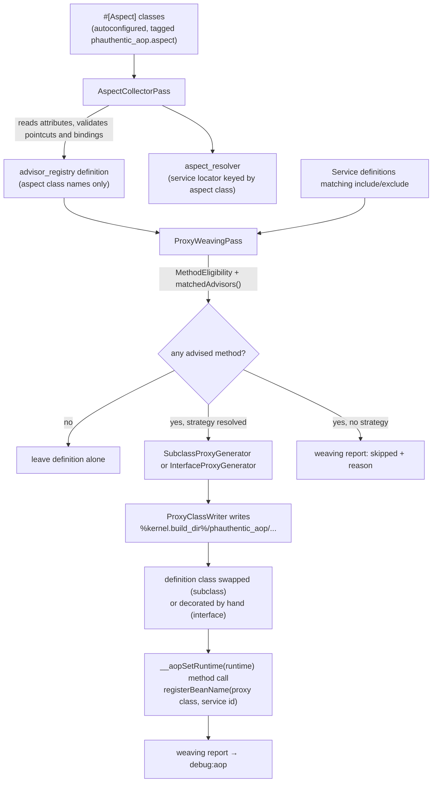

# Symfony bundle

`phauthentic/symfony-aop` (namespace `Phauthentic\AOP\Symfony\`, repository [Phauthentic/aop-symfony](https://github.com/Phauthentic/aop-symfony)) discovers aspects, weaves proxies at container build time and ships `debug:aop`.
It requires Symfony 7.2 components (`config`, `dependency-injection`, `http-kernel`, `console`) and PHP 8.3.
The pointcut language, advice types and proxy mechanics are documented in the [core documentation](https://github.com/Phauthentic/aop/blob/main/docs/README.md).
A complete runnable demo application lives in the demo application repository: https://github.com/Phauthentic/aop-symfony-example.

## Installation

The packages are not on Packagist yet.
Add the repositories to your `composer.json` and require both packages:

```bash
composer config repositories.phauthentic-aop vcs https://github.com/Phauthentic/aop.git
composer config repositories.phauthentic-symfony-aop vcs https://github.com/Phauthentic/aop-symfony.git
composer require phauthentic/aop:dev-main phauthentic/symfony-aop:dev-main
```

Register the bundle in `config/bundles.php`:

```php
return [
    Symfony\Bundle\FrameworkBundle\FrameworkBundle::class => ['all' => true],
    Phauthentic\AOP\Symfony\PhauthenticAopBundle::class => ['all' => true],
];
```

Create `config/packages/phauthentic_aop.yaml`:

```yaml
phauthentic_aop:
    include: ['App\**']
```

Aspects need `autoconfigure: true` (the default in a Symfony skeleton) so the `#[Aspect]` attribute tags them.
A `#[Aspect]` class registered without autoconfiguration is ignored unless you tag it `phauthentic_aop.aspect` yourself.

## Compatibility

The bundle requires PHP 8.3 or newer and Symfony 7.2 to 8.0 (`symfony/*: ^7.2 || ^8.0`).
Symfony 8 itself requires PHP 8.4.

| PHP | Symfony 7.2 | Symfony 7.3 and 7.4 | Symfony 8.0 |
|---|---|---|---|
| 8.3 | generated lazy proxies | generated lazy proxies | not possible |
| 8.4 | generated lazy proxies | native lazy objects | native lazy objects |
| 8.5 | generated lazy proxies | native lazy objects | native lazy objects |

CI runs PHP 8.3, 8.4 and 8.5 against Symfony 7.4 and 8.0.

Everything behaves the same on all stacks except `lazy: true` services woven with the subclass strategy, which follow the two columns above.

### Native lazy objects (Symfony 7.3+ on PHP 8.4+)

Symfony builds lazy services with `ReflectionClass::newLazyGhost()` and rejects the `proxy` tag it accepted before, so the bundle cannot keep using generated lazy proxies there.
A lazy woven service is a native lazy ghost of the proxy class itself.
The object the container hands out is the advised object: it is an `AdvisedInterface`, it implements interfaces added with `#[DeclareParents]`, and `instanceof` the target class holds.

Two properties of native lazy objects shape the implementation, and both are handled by the generated proxies, so nothing changes for application code:

- A native lazy object initializes only when one of its properties is accessed.
  An advised method does not touch a property before it resolves its runtime, so the proxy initializes an uninitialized lazy object itself before the first advised call, which runs the constructor and the runtime wiring first.
- A class without any property counts as initialized from the start and never runs its initializer.
  Every proxy therefore declares one never-assigned private property, so lazy ghosts of proxies of property-less classes stay lazy.

A native lazy proxy of the *target* class, with the advised instance as its real object, was evaluated and rejected: a method that does not access a property runs on the uninitialized stand-in and bypasses the advice silently.

The dumped container creates the ghost through `new \ReflectionClass(<proxy class>)` before the service includes the proxy autoload file.
The weaving pass therefore writes the pointer file `phauthentic_aop.proxy_dir` next to the dumped container, and `ProxyAutoloader`, registered in the bundle constructor, finds proxy directories through it on the first miss.
A bundle that fetches a lazy woven service in its own `boot()` before `PhauthenticAopBundle` boots works because of this.

### Generated lazy proxies (PHP 8.3, or Symfony 7.2)

The definition gets the tag `proxy` with `interface: <target class>`, and Symfony builds a lazy proxy of the target class that forwards to the advised instance.
That outer object is not an `AdvisedInterface` and does not implement introduced interfaces; call `initializeLazyObject()` to reach the advised instance.

### PHP 8.5

PHP 8.5 reflection reports the resolved class name instead of the keyword for a `self` return type.
Type patterns match `self` and `parent` both as the keyword and as the class they resolve to, so pointcuts behave the same on every PHP version (see the [pointcut reference](https://github.com/Phauthentic/aop/blob/main/docs/pointcuts.md#execution)).

### Static analysis

Both the core and the bundle repository run PHPStan with `phpVersion: 80400`, because the native lazy object API used behind runtime checks does not exist in the PHP 8.3 stubs.
Keep that setting when adding PHP 8.4 only calls behind a `PHP_VERSION_ID` guard.

## Configuration reference

```yaml
phauthentic_aop:
    enabled: true                                   # false removes every bundle service, including debug:aop
    proxy_strategy: auto                            # auto | subclass | interface
    proxy_dir: '%kernel.build_dir%/phauthentic_aop' # where generated proxies and autoload.php are written
    include: ['App\**']                             # type patterns of classes eligible for weaving
    exclude: []                                     # type patterns never woven
    strip_final: false                              # risky, see "strip_final (opt-in, risky)"
    strip_final_include: ['App\**']                 # type patterns whose `final` may be removed; defaults to include
```

| Key | Default | Meaning |
|---|---|---|
| `enabled` | `true` | When `false`, `PhauthenticAopExtension::load()` returns before loading any service, so nothing is woven and `debug:aop` does not exist. |
| `proxy_strategy` | `auto` | `auto` picks subclass for non-final classes and interface for final classes with interfaces. `subclass` or `interface` forces one; services where it cannot apply are reported as skipped, not failed. `#[Proxyable]` on a class overrides the setting. |
| `proxy_dir` | `%kernel.build_dir%/phauthentic_aop` | Must not be empty. The directory is created on demand. |
| `include` | `['App\**']` | [Type patterns](https://github.com/Phauthentic/aop/blob/main/docs/pointcuts.md#type-patterns). A class must match at least one to be considered. |
| `exclude` | `[]` | Type patterns checked before `include`. |
| `strip_final` | `false` | When `true`, final classes and final methods are woven with subclass proxies of a copy without `final`. See [strip_final](#strip_final-opt-in-risky) before enabling it. |
| `strip_final_include` | the `include` patterns | Type patterns of classes whose `final` may be removed. An empty list means the `include` patterns. Vendor classes are only rewritten if you widen this list to cover them. |

Always excluded, regardless of configuration: `Symfony\**`, `Doctrine\**`, every class under `Phauthentic\AOP\` (except its own `\Tests\` fixtures), and every class carrying `#[Aspect]`.
Unknown keys and unknown strategy values fail configuration validation.

## How weaving works

Two compiler passes run at `PassConfig::TYPE_BEFORE_REMOVING`, after autowiring, autoconfiguration and decoration.
The diagram shows the container build.



### AspectCollectorPass (priority 1)

1. Finds every service tagged `phauthentic_aop.aspect` and resolves its class through `ContainerBuilder::getReflectionClass()`, which also registers the class file as a container resource.
2. Calls `AdvisorRegistryFactory::create($aspectClasses)` once.
   The factory reads the metadata of each aspect, compiles every pointcut, plans every parameter binding and throws `AspectDefinitionException` naming the offending aspect and method on any `AopException`.
   This is where a bad expression fails the build.
3. Stores the aspect **class names** as the argument of `phauthentic_aop.advisor_registry` and a `ServiceLocatorArgument` keyed by aspect class as the argument of `phauthentic_aop.aspect_resolver`.

Nothing compiled is serialised.
The dumped container calls `AdvisorRegistryFactory::create()` again at runtime, which keeps the weave-time and runtime views of the advisors identical.

### ProxyWeavingPass (priority 0)

For every service definition:

1. Skip abstract, synthetic and erroneous definitions, and the bundle's own `phauthentic_aop.*` services.
2. Resolve the class and check `include`/`exclude` and the always-excluded list.
3. Reflect the class (tracking its file as a resource), skip `#[Aspect]` classes and classes `MethodEligibility::isClassProxyable()` rejects.
4. Resolve the strategy (see below).
5. Collect advised methods: every method `MethodEligibility` accepts for that strategy whose static pointcut match yields at least one advisor.
   The `StaticMatchContext` carries the service id as bean name, so `bean()` works here.
6. No advised method: leave the definition alone, do not report.
   Advised methods but no usable strategy: record under `skipped` with the reason.
7. Generate the proxy, salted with `service id . "\0" . proxy_dir`, write it with `ProxyClassWriter`, and load it (the dumper needs the class to exist).
8. Write `autoload.php` into the proxy directory once per build.
9. Rewire the definition:
   - Subclass strategy: set the definition's class to the proxy class, set its `file` to `autoload.php`, append a `__aopSetRuntime('@phauthentic_aop.runtime')` method call after any existing calls.
     A lazy service becomes a native lazy ghost of the proxy class on PHP 8.4 with Symfony 7.3 or newer; on older stacks it gets the tag `proxy` with `interface: <target class>`, so Symfony builds a lazy proxy of the target class instead.
   - Interface strategy: move the original definition to `<id>.aop_target` (private, untagged), and create a new definition `<id>` with the proxy class, the original's `public`, `shared` and tags, `autoload.php` as file, the target reference as constructor argument, and the `__aopSetRuntime` call.
10. Add `registerBeanName(<proxy class>, <service id>)` to the runtime definition.
11. Store the report in the parameter `phauthentic_aop.weaving_report` and pass it to the `debug:aop` command.

### Strategy rules specific to the container

On top of `ProxyStrategyResolver`:

- A subclass-strategy service with a factory or a `file` cannot have its class swapped, so it falls back to the interface strategy.
  If the class implements no interface it is skipped: `the service is created by a factory, which needs an interface proxy, but the class implements no interface`.
- A **tagged** service that would get an interface proxy is skipped when it has public, non-static methods not declared by any of its interfaces:
  `an interface proxy would hide method onOrderPlaced(), which tag kernel.event_subscriber may reference`.
  Tags like `kernel.event_subscriber`, `controller.service_arguments` or `messenger.message_handler` are processed before weaving and may call those methods.
  The same class without tags is proxied.

### The bean() designator

`bean(id)` is a core designator (see the [pointcut reference](https://github.com/Phauthentic/aop/blob/main/docs/pointcuts.md#bean)).
The bundle fills the bean name with the service id of the definition being woven, so `bean(id)` matches against that id.
For autowired services the id is the class name, so `bean(App\Service\StringService)` works, as do `bean(app.mailer)` and `bean(app.*)`.
Two services of the same class with different ids get distinct proxy classes, each registered with `AopRuntime::registerBeanName()`, so `bean()` distinguishes them at runtime too.
When looking a name up, the runtime walks from the runtime class of the proxy up its parent chain, so a subclass of a proxy class resolves to the proxy's name as well.

### Lazy services

A lazy woven service stays lazy.
What the container hands out depends on the stack; the [compatibility section](#compatibility) has the overview.

**PHP 8.4 with Symfony 7.3 or newer** uses native lazy objects.
The service is a lazy ghost of the proxy class itself, so it is an `AdvisedInterface`, it implements interfaces added with `#[DeclareParents]`, and `instanceof` the target class holds.
Native lazy objects initialize on property access, which an advised method does not do before it looks up its runtime.
The generated `__aopRuntime()` accessor therefore initializes an uninitialized lazy object before the first advised call, which runs the constructor and the `__aopSetRuntime` call, so the first call is advised as well.
The dumped container creates the ghost through `new \ReflectionClass(<proxy class>)` before the service includes `autoload.php`, so the proxy class must be autoloadable at that point.
For that the weaving pass writes the pointer file `phauthentic_aop.proxy_dir` into `kernel.build_dir`, next to the dumped container, and `ProxyAutoloader` (registered in the bundle constructor) reads it on the first miss by looking beside every included `*Container.php` file.
This also covers a bundle whose `boot()` fetches a lazy woven service before `PhauthenticAopBundle` boots.

**Older stacks** (PHP 8.3, or Symfony 7.2) cannot use native lazy objects.
There the definition gets the tag `proxy` with `interface: <target class>`, and Symfony builds a lazy proxy of the target class that forwards to the advised instance.
That outer object is not an `AdvisedInterface` and does not implement introduced interfaces; call `initializeLazyObject()` to reach the advised instance.
An interface added with `#[DeclareParents]` therefore exists on the inner instance only (see [Introductions](https://github.com/Phauthentic/aop/blob/main/docs/introductions.md)).
A generated lazy ghost of the proxy class is not an option on these stacks: the ghost class file is required by `Container::createProxy()` before the service includes `autoload.php`, and the debug dumper inlines `include_once $container->targetDir…` into the ghost file, where `$container` is undefined.

### Introductions

The bundle applies introductions while weaving (`ProxyWeavingPass`), records them per service in the weaving report and lists them in the "Introduced interfaces" section of `bin/console debug:aop` (see [debug:aop](#debugaop)).

The woven service implements the introduced interface, but the bundle registers no autowiring alias for it.
A constructor parameter typed with the introduced interface is therefore not autowired.
Inject the service by its id or its own type and check `instanceof`, or add an alias yourself, for example `App\Contract\Auditable: '@App\Service\OrderService'`.

### Proxy autoloading

Every woven definition has `autoload.php` as its `file`, which runs `ProxyAutoloader::register(__DIR__)` before the service is instantiated.
This covers the case where another bundle's `boot()` fetches a woven service before `PhauthenticAopBundle::boot()` has run.
`PhauthenticAopBundle::boot()` registers the directory as well, for code that needs a proxy class without touching a service first, for example `unserialize()`.
`ProxyAutoloader` only reacts to classes under `Phauthentic\AOP\Generated\`.

## strip_final (opt-in, risky)

`strip_final` is off by default, and nothing changes unless you enable it.
It lets final classes without an interface, and final methods, be advised by subclass proxies.
Prefer giving the class an interface: interface proxies need no rewriting and keep `final` meaningful.

```yaml
phauthentic_aop:
    strip_final: true
    strip_final_include: ['App\Service\**']   # optional, defaults to include
```

What it does for a service whose class matches `strip_final_include`, is not lazy and has no `#[Proxyable]`:

- The class resolves like a non-final one, so `auto` picks the subclass strategy, also for final classes that implement interfaces.
- Final methods declared in the class file become advisable; final methods inherited from parents or traits are still skipped.
- If the class or an advised method is final, `FinalStripper` removes every `final` token from the class file and writes the copy to `<proxy_dir>/unfinalized/<hash>.php`.
  The copy keeps the namespace, class name and everything else; only the `final` modifiers are gone.
  `__DIR__` and `__FILE__` in the copy are replaced by string literals of the original file's directory and path, so relative includes and paths keep working.
- `<proxy_dir>/unfinalized/map.php` maps the class to its copy, its original file and its proxies.
  `ProxyAutoloader::register()`, run by `autoload.php` and by `PhauthenticAopBundle::boot()`, reads the map and prepends an autoloader to Composer's, so the copy is loaded instead of the original.
- The woven definition gets the `container.no_preload` tag.
  The original file of every class loaded from its copy, woven or not, is a container resource, so editing it rebuilds the container and the copy.
- The proxy extends the class, so it *is* an `instanceof` the class and consumers see no difference.

Risks and limits:

- It breaks the `final` contract process-wide for those classes: any code can extend them once the copy is loaded.
- PHP cannot replace a loaded class.
  A class loaded before the kernel boots (used in `public/index.php`, a bundle's `build()`, or by opcache preloading) cannot be stripped.
  Fetching its service then throws a `ProxyGenerationException` that explains this, instead of a fatal error.
- Preloading: the bundle keeps woven definitions out of the container's preload list, but another preloaded class that references the original (for example as a parameter type) preloads it anyway.
  Exclude such classes from `strip_final_include`, or do not use `opcache.preload` with this option.
- The process that compiles the container usually has the original loaded already, because autowiring reflects every service class.
  The pass then writes the proxy without loading it, and that process cannot use the service: in `dev`, the request that rebuilt the container fails for it, the next one works.
  `debug:aop` shows such services with a warning.
  If the class is not loaded yet, the pass loads the copy in the compiling process too, and the report says `finalStripped: true` without a warning.
- Lazy services are never stripped; they are skipped with the usual reason.
- `ReflectionClass::getFileName()` of a stripped class returns the path of the copy in `<proxy_dir>/unfinalized/`, not the original file.
  Tools that read the class file through reflection, for example to parse annotations in docblocks or to map a class to its source, see the copy.

The [proxy reference](https://github.com/Phauthentic/aop/blob/main/docs/proxies.md#two-strategies) lists `strip_final` as the way to advise final classes and final methods with the subclass strategy.
`debug:aop` marks such services with `subclass (final stripped)` in the Strategy column and lists warnings in a "Warnings" section.

## Cache and rebuild behaviour

- Proxies live in `%kernel.build_dir%/phauthentic_aop/`, next to the dumped container.
  `cache:clear` removes them with the rest of the build directory.
  Nothing is written to your `src/` directory.
- Aspect classes and target classes are container resources.
  In debug mode, editing an aspect or an advised service triggers a container rebuild, which regenerates the proxies.
- Proxy file names contain a hash over the class, strategy, advised methods, service id and proxy directory.
  Changing which methods are advised produces a new file; the old one stays until `cache:clear`.
- Proxy and autoload files are written atomically (temporary file plus `rename`).
- Two kernels with different cache directories in one process work, because the salt includes the directory and the autoloader checks every registered directory.

## debug:aop

```
$ bin/console debug:aop

Advised services
----------------

 --------------------------- ----------- ------------ -------------------------------------------- ------------------
  Service                     Strategy    Method       Advice                                       Runtime
 --------------------------- ----------- ------------ -------------------------------------------- ------------------
  App\Service\OrderService    interface   placeOrder   App\Aspect\AuditIntroductionAspect::record   yes (this)
                                                       App\Aspect\LoggingAspect::before
                                                       App\Aspect\LoggingAspect::after
  App\Service\StringService   subclass    reverse      App\Aspect\AuditIntroductionAspect::record   yes (this)
                                                       App\Aspect\LoggingAspect::before
                                                       App\Aspect\LoggingAspect::after
  App\Service\StringService   subclass    upper        App\Aspect\AuditIntroductionAspect::record   yes (this)
                                                       App\Aspect\LoggingAspect::before
                                                       App\Aspect\LoggingAspect::after
                                                       App\Aspect\CachingAspect::around
  App\Service\StringService   subclass    greet        App\Aspect\AuditIntroductionAspect::record   yes (this, args)
                                                       App\Aspect\LoggingAspect::before
                                                       App\Aspect\LoggingAspect::after
                                                       App\Aspect\ValidationAspect::before
  App\Service\StringService   subclass    flaky        App\Aspect\AuditIntroductionAspect::record   yes (this)
                                                       App\Aspect\LoggingAspect::before
                                                       App\Aspect\LoggingAspect::after
                                                       App\Aspect\RetryAspect::around
 --------------------------- ----------- ------------ -------------------------------------------- ------------------

 runtime: statically matched, but evaluated again per call; the advice may be skipped.

Introduced interfaces
---------------------

 --------------------------- ------------------------ -------------------------
  Service                     Interface                Default implementation
 --------------------------- ------------------------ -------------------------
  App\Service\OrderService    App\Contract\Auditable   App\Contract\AuditTrail
  App\Service\StringService   App\Contract\Auditable   App\Contract\AuditTrail
 --------------------------- ------------------------ -------------------------

Skipped services
----------------

 No advised service was skipped.
```

The Advice column lists advisors in chain order (outermost first).
An advisor appears as soon as its static pointcut half matches.
The Runtime column marks a method with `yes` when one of its advisors is evaluated again per call, and names the runtime designators of its expression, such as `args` or `this`.
A static advisor adds nothing to that column, and a method without any runtime advisor shows `-`.
The footnote below the table appears only when some row is runtime, because a runtime advisor may be skipped for a given call.
Services with no matching advice at all are not listed, unless an introduction applies to them.
The "Introduced interfaces" section lists, per service, each interface added by `#[DeclareParents]` and its default implementation (see [Introductions](https://github.com/Phauthentic/aop/blob/main/docs/introductions.md)).

For services woven with the interface strategy, the weaving pass scans the target class file for `$this->name(` calls to advised methods.
They bypass advice, so `debug:aop` lists them in a separate section, computed at compile time:

```
Self-invocations that bypass advice
-----------------------------------

 * App\Service\OrderService  App\Service\OrderService::placeOrder() -> audit()  /app/src/Service/OrderService.php:23

 Inside an interface-proxied target $this is the plain object. Call AopContext::currentProxy()->method() instead.
```

The scan is a token scan of one file per service.
It does not see calls through other variables or dynamic method names, and is skipped when the class has no file.
The section is omitted when nothing is found.

A skipped entry looks like:

```
 * App\Service\FinalNoInterfaceService (App\Service\FinalNoInterfaceService): the class is final and implements no interface
```

## Troubleshooting

| Symptom | Cause | Fix |
|---|---|---|
| `AspectDefinitionException: Invalid advice App\Aspect\X::y(): Unexpected ")" at position N in pointcut "..."` | Syntax error in the expression. | Check the [grammar](https://github.com/Phauthentic/aop/blob/main/docs/pointcuts.md#grammar); the position is a byte offset into the expression. |
| `... Unsupported pointcut designator "cflow".` | AspectJ designator this library does not implement. | Rewrite with `execution`, `within`, `args`, attributes or `bean`. |
| `... Cannot bind parameter $x of ...` | Advice parameter that is neither a join point, nor `returning`/`throwing`, nor named in the pointcut. | Rename it to a binding or remove it. See [Advice parameters](https://github.com/Phauthentic/aop/blob/main/docs/advice.md#parameters). |
| `... Pointcut binds [a] in one branch of "\|\|" and [] in the other` | `\|\|` branches bind different names. | Bind the same names in every branch or split into two advice methods. |
| `... Around advice ... must declare a Phauthentic\AOP\JoinPoint\ProceedingJoinPointInterface parameter.` | `#[Around]` without a proceeding join point. | Add the parameter. |
| `... Unknown named pointcut "App\Aspect\C::p()"` | Typo, or the referenced method lacks `#[Pointcut]`. | Check the class and method name. |
| `AspectDefinitionException: Class "X" is not an aspect: missing #[Aspect] attribute.` | A class was tagged `phauthentic_aop.aspect` or referenced as a named pointcut holder without the attribute. | Add `#[Aspect]`. |
| `InvalidArgumentException: Aspect service "x" has no loadable class.` | The tagged service's class cannot be reflected. | Fix the class name or autoloading. |
| Service listed under "Skipped services": `the class is final and implements no interface` | Auto strategy has nothing to generate. | Remove `final` or extract an interface. |
| Skipped: `an interface proxy would hide method ...` | Tagged service with public methods outside its interfaces. | Make the class non-final (subclass strategy), move the methods into an interface, or remove the tag. |
| Skipped: `Cannot create a subclass proxy for final class ...` | `proxy_strategy: subclass` forced on a final class. | Use `auto`, or `#[Proxyable(ProxyStrategy::INTERFACE)]` on that class. |
| `Cannot load the AOP proxy ...: phauthentic_aop.strip_final needs ... to be loaded from its copy without "final"` | With `strip_final`, the final original was loaded before the kernel booted, or by preloading, or this process compiled the container. | Load the class only after the kernel boots, or exclude it from `strip_final_include`. |
| Advice does not run, `debug:aop` does not list the service | The class is outside `include`, inside `exclude`, carries `#[Aspect]`, or no pointcut matches statically. | Check patterns; remember `*` does not cross `\`, use `**`. |
| Advice listed but does not run for some calls | Runtime half of the pointcut (`args`, `@args`, bindings) does not match. | Check argument types and the binding parameter's type. |
| Advice runs for external calls but not for `$this->method()` | Interface proxy; self-invocation bypasses it. | Make the class non-final so it gets a subclass proxy. |
| `AdviceReturnException: Around advice ... returned int, but ... is declared to return string.` | An `#[Around]` advice returned a value of the wrong type. | Return what the target's signature promises. |
| `ProxyGenerationException: Cannot write proxy file ...` | Proxy directory not writable. | Fix permissions on `proxy_dir`. |
| Injected `OrderService` typed property receives a `TypeError` | Final class with interface proxy; the proxy is not an `OrderService`. | Type-hint the interface. |

## Services registered by the bundle

| Id | Class | Purpose |
|---|---|---|
| `phauthentic_aop.advisor_registry` | `AdvisorRegistry` via `AdvisorRegistryFactory::create()` | All advisors, sorted. |
| `phauthentic_aop.aspect_resolver` | `ContainerAspectInstanceResolver` | Resolves aspect instances from a service locator, one per target or proxy for `pertarget`/`perthis` aspects. |
| `phauthentic_aop.parameter_binder` | `ParameterBinder` | Plans advice parameter binding. |
| `phauthentic_aop.chain_factory` | `AdvisorChainFactory` | Builds interceptor chains. |
| `phauthentic_aop.runtime` | `AopRuntime` | Called by proxies; holds bean name registrations. |
| `phauthentic_aop.command.debug` | `DebugAopCommand` | `debug:aop`. |

All are private.

## Aspect scopes

The scopes themselves are described in [Advice](https://github.com/Phauthentic/aop/blob/main/docs/advice.md#scopes).
An aspect with `#[Aspect(scope: AspectScope::PER_TARGET)]` or `PER_THIS` is registered with `shared: false` automatically.
You do not set it yourself.
`ContainerAspectInstanceResolver` asks the locator once per target or proxy object and keeps the result in a `WeakMap`.
`debug:aop` prints the scope after the aspect class, for example `App\Aspect\CallCounter (pertarget)::count`.
Singleton aspects are shown without a suffix.

## Aspect instances

`ContainerAspectInstanceResolver` pulls the aspect from a service locator on first use.
Aspects stay private services, may depend on anything, and a cycle between an aspect and a service it advises is fine because the aspect is resolved only when the first advised call happens.
A class referenced as a named pointcut holder must be an `#[Aspect]`, but it does not need to be a registered service, because the resolver reflects it on demand.
Invalid advice raises an `AspectDefinitionException` at container build time whose message names the aspect class and method: `Invalid advice App\Aspect\X::y(): ...`.

## Bundle internals

The bundle lives in `Phauthentic/aop-symfony`:

```
Phauthentic/aop-symfony            phauthentic/symfony-aop  Phauthentic\AOP\Symfony\
├── src/
├── docs/
└── tests/                         Phauthentic\AOP\Symfony\Tests\ (Integration/, Fixtures/)
```

It requires `phauthentic/aop` and adds `symfony/config`, `symfony/dependency-injection`, `symfony/http-kernel` and `symfony/console` at `^7.2 || ^8.0`.

| Class | Responsibility |
|---|---|
| `PhauthenticAopBundle` | Registers `#[Aspect]` autoconfiguration (tag `phauthentic_aop.aspect`), adds both passes at `TYPE_BEFORE_REMOVING`, registers the proxy autoloader in `boot()`. |
| `DependencyInjection\Configuration` | The `phauthentic_aop` config tree and defaults. |
| `DependencyInjection\PhauthenticAopExtension` | Loads `Resources/config/services.php` and sets the four parameters, unless `enabled: false`. |
| `Compiler\AspectCollectorPass` | Collects aspects, validates, wires registry argument and aspect locator. |
| `Compiler\ProxyWeavingPass` | Matches, generates, writes, rewires definitions, produces the weaving report. |
| `Container\AdvisorRegistryFactory` | `create(array $aspectClasses): AdvisorRegistry`, used at compile time and as the runtime service factory. Wraps failures in `AspectDefinitionException` naming aspect and method. |
| `Container\ContainerAspectInstanceResolver` | `AspectInstanceResolverInterface` over a service locator. |
| `ProxyAutoloader` | `spl_autoload_register` for `Phauthentic\AOP\Generated\*` across every registered proxy directory; produces the contents of `autoload.php`. |
| `Command\DebugAopCommand` | Renders the weaving report. |

### Tests

```bash
composer check     # cs (php-cs-fixer --dry-run), stan (phpstan level max), test (phpunit)
```

The `integration` suite (`tests/`) runs the compiler passes against a real `ContainerBuilder`, covers the configuration and `debug:aop`, and uses a `TestKernel` that boots from a temporary cache directory.
It includes a separate-process boot through `Fixtures/boot.php` to prove the dumped container loads proxies without rebuilding.
The demo application has an `e2e` suite (`tests/E2E/`) that asserts the exact `app:aop-demo` output, the `debug:aop` content, and that proxies land only in `var/cache/test/phauthentic_aop`.

When changing anything that affects what gets advised, update the expected output in `tests/E2E/AopDemoCommandTest.php` of the demo application and the real-output block in [debug:aop](#debugaop).
